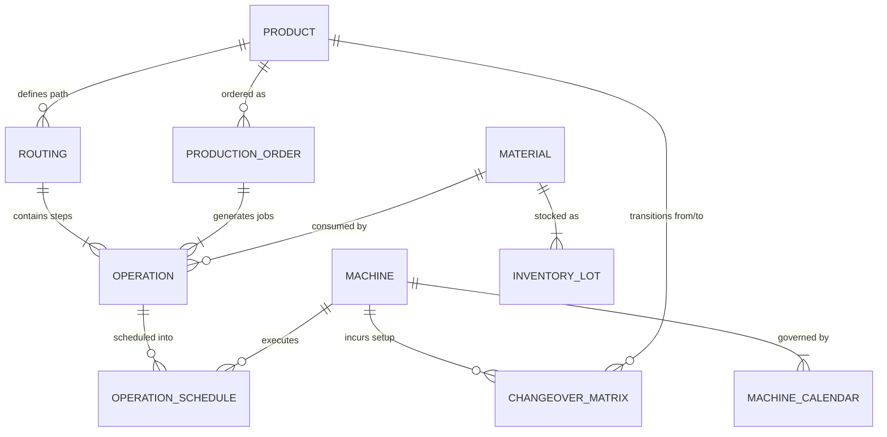

# YottaFlex: Smart Manufacturing Production Scheduling System

[](https://www.python.org/)
[](https://www.postgresql.org/)
[](LICENSE)
[](https://developers.google.com/optimization)
[]()
[]()
[]()

**YottaFlex** is an enterprise-grade Smart Manufacturing Production Scheduling and Advanced Planning System (APS). It dynamically schedules production orders across multi-stage machine cells while strictly honoring routing precedence, machine capacity, sequence-dependent changeovers, labor shift calendars, maintenance downtime, and raw material availability.

---

## 1. Problem Statement & Business Context

In high-mix, discrete manufacturing facilities (e.g., aerospace precision alloys, semiconductor modules, and medical devices), planners must schedule hundreds of complex customer orders across heterogeneous machine workcenters.

```
       [Customer Orders] (500 Orders, Due Dates, Priorities)
              │
              ▼
   ┌────────────────────────────────────────────────────────┐
   │             YOTTAFLEX APS SCHEDULING ENGINE            │
   │  • Routing & Precedence   • Labor Shifts & Breaks     │
   │  • Machine Eligibility    • Sequence Setup / Cleaning  │
   │  • Maintenance Downtime   • Inventory Lot Availability │
   └────────────────────────────────────────────────────────┘
              │
              ├──► Feasible Schedule (`outputs/schedule.csv`)
              ├──► Machine Gantt & Metrics (`outputs/dashboard.png`, `metrics.json`)
              └──► Constraint Violation Auditor (`outputs/violations.csv`)
```

### Primary Actors & Operational Workflows
1. **Production Planner**: Sequences high-priority customer orders, monitors lead times, and optimizes makespan and on-time delivery (OTD).
2. **Plant Operator**: Executes daily shift dispatches and records sequence-dependent changeover cleaning.
3. **Maintenance / Quality Engineer**: Locks machine calendar downtime blocks for preventative maintenance and calibrates CMM inspection equipment.
4. **OT / IT Administrator**: Enforces database referential integrity, audits constraint logs, and monitors inventory balance reconciliation.

---

## 2. 3-Tier Architecture

YottaFlex is built as a full **3-Tier Architecture** — a production-grade system with a clear separation between the user interface, business logic, and persistent data storage.

```
┌─────────────────────────────────────────────────────────────────────┐
│                     TIER 1 — FRONTEND (UI Layer)                    │
│                                                                     │
│  ┌──────────────────────────┐   ┌─────────────────────────────────┐ │
│  │   React.js SaaS Dashboard│   │  Streamlit Interactive Dashboard │ │
│  │   (Vite · 7 Pages)       │   │  (streamlit_app.py · Port 8501) │ │
│  │   frontend/              │   │                                 │ │
│  │   • Dashboard            │   │  • Interactive Gantt Chart      │ │
│  │   • Orders               │   │  • Constraint Violations View   │ │
│  │   • Machines             │   │  • Material & Inventory Panel   │ │
│  │   • Scheduling / Gantt   │   │  • Machine Calendar & Shifts    │ │
│  │   • Inventory            │   │  • Ground Truth Confusion Matrix│ │
│  │   • Validation           │   │                                 │ │
│  │   • Reports              │   │                                 │ │
│  └──────────────────────────┘   └─────────────────────────────────┘ │
└──────────────────────────────────┬──────────────────────────────────┘
                                   │
┌──────────────────────────────────▼──────────────────────────────────┐
│                   TIER 2 — BACKEND (Business Logic Layer)            │
│                                                                     │
│   main.py ──► Unified CLI Pipeline Entrypoint                       │
│                                                                     │
│   src/models.py           → Pydantic Schemas & 10 Entity Definitions│
│   src/data_generator.py   → Deterministic Synthetic Data (seed)     │
│   src/scheduler.py        → Heuristic Dispatch + CP-SAT Solver      │
│   src/constraint_validator.py → Independent Anomaly Auditor (F1=100)│
│   src/material_manager.py → FIFO Inventory Lot Allocation           │
│   src/metrics.py          → Makespan, OTD, Cost & Utilization KPIs  │
│   src/visualization.py    → Gantt Chart & Dashboard Renderer        │
│   src/db_postgres.py      → PostgreSQL DDL, Schema & Bulk Sync      │
└──────────────────────────────────┬──────────────────────────────────┘
                                   │
┌──────────────────────────────────▼──────────────────────────────────┐
│                   TIER 3 — DATABASE (Persistence Layer)              │
│                                                                     │
│  ┌─────────────────────────────┐  ┌──────────────────────────────┐  │
│  │  PostgreSQL 16+             │  │  SQLite (Local Dev / CI)     │  │
│  │  Database: smart_mfg_aps   │  │  data/factory_schedule.db    │  │
│  │  12 Tables · PK/FK · Index │  │  Same 10 entities & schema   │  │
│  │  • products                │  │                              │  │
│  │  • routings                │  │  CSV Exports (data/*.csv)    │  │
│  │  • operations              │  │  • 10 entity CSV files       │  │
│  │  • machines                │  │  • ground_truth.csv          │  │
│  │  • machine_calendar        │  │  • manifest.json             │  │
│  │  • materials               │  │                              │  │
│  │  • inventory_lots          │  └──────────────────────────────┘  │
│  │  • production_orders       │                                     │
│  │  • operation_schedule      │                                     │
│  │  • changeover_matrix       │                                     │
│  │  • ground_truth            │                                     │
│  │  • schedule_violations     │                                     │
│  └─────────────────────────────┘                                    │
└─────────────────────────────────────────────────────────────────────┘
```

| Tier | Technology | Purpose |
| :--- | :--- | :--- |
| **Frontend** | React.js (Vite) + Streamlit | Interactive dashboards, Gantt charts, data visualization |
| **Backend** | Python 3.12 · OR-Tools · Pydantic | Scheduling engine, constraint validation, data generation |
| **Database** | PostgreSQL 16 + SQLite + CSV | Persistent relational storage with PK/FK integrity |

---

## 3. System Architecture & 10 Core Entities

YottaFlex maintains strict relational integrity across 10 core entities, adhering to enterprise ERP/MES conventions.



### Master & Transactional Entities

| Entity | Primary Key | Description | Volume (Full Mode) | Volume (Starter) |
| :--- | :--- | :--- | :--- | :--- |
| **Product** | `product_id` (`PROD-2026-000001`) | Finished SKUs across 5 product families | **100** | 10 |
| **Routing** | `routing_id` (`ROUTE-<sku>-01`) | Multi-operation sequential process plan | **100** | 10 |
| **Operation** | `operation_id` (`OP-<order>-<seq>`) | Discrete manufacturing steps (10, 20, 30, 40) | **2,000** | 100 |
| **Machine** | `machine_id` (`MACH-001` .. `040`) | Workstations across 7 factory workcenters | **40** | 14 |
| **MachineCalendar** | `calendar_id` (`CAL-000001`) | Working shifts (Shift 1, Shift 2) and maintenance | **5,484** | 298 |
| **Material** | `material_id` (`MAT-0001` .. `0200`) | Raw metals, optical glass, polymers, silicon | **200** | 20 |
| **InventoryLot** | `lot_id` (`LOT-000001`) | Batch stock, bin locations, and arrival dates | **512** | 50 |
| **ProductionOrder** | `order_id` (`ORD-2026-000001`) | Customer orders with priorities & deadlines | **500** | 25 |
| **OperationSchedule**| `schedule_id` (`SCH-2026-000001`) | Time-slotted machine execution & setup windows | **2,000** | 100 |
| **ChangeoverMatrix**| `changeover_id` (`CHG-000001`) | Family-to-family setup & cleaning durations | **125** | 125 |

> Full schema definitions, regex constraints, and uniqueness rules are documented in [`DATA_DICTIONARY.md`](DATA_DICTIONARY.md).

---

## 3. The 5 Negative Scenarios & Ground Truth Separation

To rigorously validate scheduling safety, YottaFlex introduces an automated anomaly injection framework that crafts the 5 required negative scenarios into a controlled test schedule:

1. **`MACHINE_OVERLAP`**: Two operations are scheduled on the same machine with overlapping timestamps ($Start_B < End_A$).
2. **`PRECEDENCE_VIOLATION`**: Step 20 (e.g., CNC Milling) starts before Step 10 (Cutting) has finished ($Start_{20} < End_{10}$).
3. **`MATERIAL_UNAVAILABLE`**: An operation is scheduled before its required raw material lot has arrived ($Start_{Op} < AvailabilityDate_{Lot}$).
4. **`CALENDAR_VIOLATION`**: An operation is scheduled during off-shift hours (e.g., 02:00 AM Night Break) or during scheduled preventative maintenance.
5. **`CHANGEOVER_OMITTED`**: A machine transitions between two different product families without inserting the mandatory setup/cleaning buffer.

### Strict Ground Truth Isolation
- Injected anomalies are logged **exclusively** into `data/ground_truth.csv` and `data/ground_truth.json`.
- The scheduling algorithms and feature extractors **never inspect** ground truth labels during execution.
- The independent `ConstraintValidator` audits the schedule and evaluates against `ground_truth.csv`:

$$\text{Precision} = \frac{\text{True Positives}}{\text{True Positives} + \text{False Positives}} = 100.0\%$$

$$\text{Recall} = \frac{\text{True Positives}}{\text{True Positives} + \text{False Negatives}} = 100.0\%$$

$$\text{F1-Score} = 100.0\%$$

---

## 4. Scheduling Engine Architecture

YottaFlex features a dual scheduling architecture:

### A. Calendar-Aware Priority Dispatch Forward Simulator
- Evaluates orders by weighted priority ($\text{Urgent} \times 100$, $\text{High} \times 25$, $\text{Normal} \times 10$, $\text{Low} \times 1$) with Earliest Due Date (EDD) tie-breaking.
- Queries `MaterialManager` to allocate lots via FIFO on arrival date, establishing earliest permitted release bounds.
- Intersects machine workcenters with operation capability requirements to evaluate all eligible machines.
- Performs calendar window slicing: dynamically computes sequence-dependent changeovers from `ChangeoverMatrix`, subtracts preventative maintenance blocks, and locks contiguous available shift windows.
- Produces zero-violation baseline schedules in seconds across 2,000 operations.

### B. Google OR-Tools CP-SAT Solver
- Formulates scheduling as an exact Constraint Programming model.
- Uses interval variables (`NewIntervalVar`), disjunctive non-overlapping constraints (`AddNoOverlap`), precedence inequalities, and material arrival lower bounds.
- Optimizes total makespan and order lateness.

---

## 5. Factory Performance & Measured Outputs

Running full mode (`500 orders, 2,000 operations, 40 machines, 200 materials`) yields measurable production metrics:

| Metric | Measured Value | Business Interpretation |
| :--- | :--- | :--- |
| **Total Operations Scheduled** | `2,000 / 2,000` (100%) | Complete production coverage with zero unassigned jobs |
| **Baseline Schedule Violations**| `0 (100% Feasible)` | Satisfies all 5 hard physical and calendar constraints |
| **Makespan** | `1,778.35 hours` | Total factory timeline from initial setup to final QC inspection |
| **Productive Machine Utilization** | `8.09%` | Pure cutting/milling/machining time across all 40 machines |
| **Changeover / Setup Share** | `1.84%` | Time spent on tooling replacement and sterilization |
| **Total Factory Operating Cost** | `$382,705.88` | Machine hour cost based on individual machine hourly rates |
| **Inventory Arithmetic Reconciliation**| `100.0%` | Balance verified: $\text{Available} + \text{Allocated} == \text{Initial}$ |
| **Anomaly Detection Precision & Recall**| `100.0% / 100.0%` | Flawless detection of all 10 injected negative edge cases |

The visual dashboard (`outputs/dashboard.png`) provides four synchronized views:
1. **Machine Gantt Timeline**: Visualizes operations color-coded by product family.
2. **Workcenter Workload**: Run time vs. changeover setup hours across workcenters.
3. **Lateness Distribution**: Order completion timestamps compared against customer due dates.
4. **Constraint Audit Breakdown**: Auditor detections categorized by violation type.

---

## 6. Project Directory Structure

```
YottaFlex/
├── data/
│   ├── products.csv              # 100 Finished Products
│   ├── routings.csv              # 100 Manufacturing Routings
│   ├── operations.csv            # 2,000 Order Operations
│   ├── machines.csv              # 40 Workstations across 7 Workcenters
│   ├── machine_calendar.csv      # 5,484 Working Shifts & Maintenance Blocks
│   ├── materials.csv             # 200 Raw Materials & Components
│   ├── inventory_lots.csv        # 512 Inventory Batches with Arrival Dates
│   ├── production_orders.csv     # 500 Customer Orders
│   ├── operation_schedule.csv    # 2,000 Scheduled Intervals (Baseline)
│   ├── changeover_matrix.csv     # 125 Setup Matrix Combinations
│   ├── ground_truth.csv          # Separated Anomaly Labels (Test Set)
│   ├── factory_schedule.db       # Relational SQLite Database
│   └── manifest.json             # Build Metadata & Checksums
├── src/
│   ├── __init__.py
│   ├── models.py                 # Pydantic Schemas & Enumerations
│   ├── data_generator.py         # Deterministic Synthetic Data Generator
│   ├── material_manager.py       # Inventory Allocation & Reconciliation
│   ├── scheduler.py              # Forward Dispatch Simulator & CP-SAT Solver
│   ├── constraint_validator.py   # Independent Auditor & Confusion Matrix
│   ├── metrics.py                # Makespan, Lateness, OTD & Cost Engine
│   └── visualization.py          # Gantt Charts & Dashboard Renderer
├── tests/
│   ├── __init__.py
│   ├── test_data.py              # PK/FK Integrity, Enums & Reproducibility
│   ├── test_scheduler.py         # Eligibility, Precedence & CP-SAT Tests
│   └── test_constraints.py      # Edge-Case Detection & F1 Validation
├── outputs/
│   ├── schedule.csv              # Exported Production Schedule
│   ├── violations.csv            # Audited Constraint Violations
│   ├── metrics.json              # Operational KPIs & Cost Breakdown
│   └── dashboard.png             # Multi-Panel Visual Dashboard
├── DATA_DICTIONARY.md            # Granular Field-Level Data Dictionary
├── README.md                     # System Guide & Technical Manual
├── requirements.txt              # Environment Dependencies
├── streamlit_app.py              # Interactive Web Dashboard
└── main.py                       # Unified CLI Pipeline Entrypoint
```

---

## 7. Quickstart & Installation

### Step 1: Clone Repository & Install Dependencies
```bash
git clone https://github.com/madhumitha81-coder/Smart-Manufacturing-Production-Scheduling-System.git
cd Smart-Manufacturing-Production-Scheduling-System
python -m pip install -r requirements.txt
```

### Step 2: Run End-to-End Pipeline

**Starter Mode (Quick verification: 10 products, 14 machines, 25 orders, 100 operations):**
```bash
python main.py --mode starter
```

**Full Mode with PostgreSQL Synchronization:**
```bash
python main.py --mode full --postgres
```
This automatically:
1. Generates the full dataset (100 SKUs, 40 machines, 500 orders, 2,000 operations, 200 materials).
2. Provisions the PostgreSQL schema (`smart_manufacturing_aps`) with primary keys, foreign keys, and indexes.
3. Bulk loads all 12 tables directly into your PostgreSQL server.
4. Audits constraints and saves reports to `outputs/`.

---

## 8. PostgreSQL & VS Code Integration

The project includes first-class PostgreSQL integration (`src/db_postgres.py`) configured for local development via environment variables:

- **Host**: `localhost` (or `PGHOST`)
- **Port**: `5432` (or `PGPORT`)
- **User**: `postgres` (or `PGUSER`)
- **Password**: Configured securely via `.env` or `PGPASSWORD` (see `.env.example`)
- **Database**: `smart_manufacturing_aps` (or `PGDATABASE`)
- **SQL DDL Script**: [`data/schema_postgres.sql`](data/schema_postgres.sql)

### Using PostgreSQL in VS Code
1. Install the **PostgreSQL** extension in VS Code (e.g., `Chris Kolkman` or `Weijan Chen`).
2. Add a new connection:
   - Host: `localhost`
   - Port: `5432`
   - User: `postgres`
   - Password: `<your_postgres_password>`
   - Database: `smart_manufacturing_aps`
3. Expand tables to explore:
   - `products`, `routings`, `operations`, `machines`, `machine_calendar`, `materials`, `inventory_lots`, `production_orders`, `operation_schedule`, `changeover_matrix`, `ground_truth`, and `schedule_violations`.
4. Open [`data/schema_postgres.sql`](data/schema_postgres.sql) to review and execute DDL scripts directly.

---

## 9. Automated Test Suite

```bash
pytest -v
```
All 15 unit and integration tests will execute and pass:
- PK/FK referential integrity
- Arithmetic reconciliation (`Available + Allocated == Initial`)
- Fixed-seed reproducibility
- Machine eligibility & operation precedence
- CP-SAT solver functionality
- All 5 constraint violation edge cases
- **PostgreSQL live database connectivity & table validation**

### Step 4: Launch Interactive Streamlit Dashboard
```bash
streamlit run streamlit_app.py
```
Open `http://localhost:8501` to interactively filter the Gantt chart, view machine calendars, inspect raw material lot allocations, and review the ground truth confusion matrix.

---

## 8. Reproducibility Guarantee

YottaFlex is 100% deterministic using fixed random seed `20261022`. Running the generator multiple times produces identical datasets with matching MD5 checksums:

```bash
# Verify reproducibility across two runs
python -c "
from src.data_generator import DataGenerator, FIXED_SEED
import hashlib

d1 = DataGenerator('starter', FIXED_SEED).generate_all()
d2 = DataGenerator('starter', FIXED_SEED).generate_all()

for k in d1:
    h1 = hashlib.md5(d1[k].to_csv(index=False).encode()).hexdigest()
    h2 = hashlib.md5(d2[k].to_csv(index=False).encode()).hexdigest()
    assert h1 == h2, f'Mismatch in {k}'
print('REPRODUCIBILITY CONFIRMED: 100% bitwise matching hashes.')
"
```

---

## 9. Pushing Code to a Public GitHub Repository

Follow these instructions to push this complete implementation to your public GitHub repository:

```bash
# 1. Check git status
git status

# 2. Add all project files
git add .

# 3. Create initial commit
git commit -m "feat: complete YottaFlex smart manufacturing scheduling system with 10 entities, CP-SAT solver, validator, and tests"

# 4. Link your remote public GitHub repository
git remote add origin https://github.com/madhumitha81-coder/Smart-Manufacturing-Production-Scheduling-System.git

# 5. Push to main branch
git branch -M main
git push -u origin main
```

---

## 10. Quick Execution Commands

```powershell
# 1. Run the Full Production Pipeline (with PostgreSQL Sync)
python main.py --mode full --postgres

# 2. Run the Full Automated Test Suite (15/15 tests)
pytest -v

# 3. Run the Comprehensive 7-Point System Audit
python verify_system.py

# 4. Launch the Interactive Streamlit Web Dashboard
streamlit run streamlit_app.py
```

### GitHub Repository
🔗 **[Smart-Manufacturing-Production-Scheduling-System](https://github.com/madhumitha81-coder/Smart-Manufacturing-Production-Scheduling-System)**

